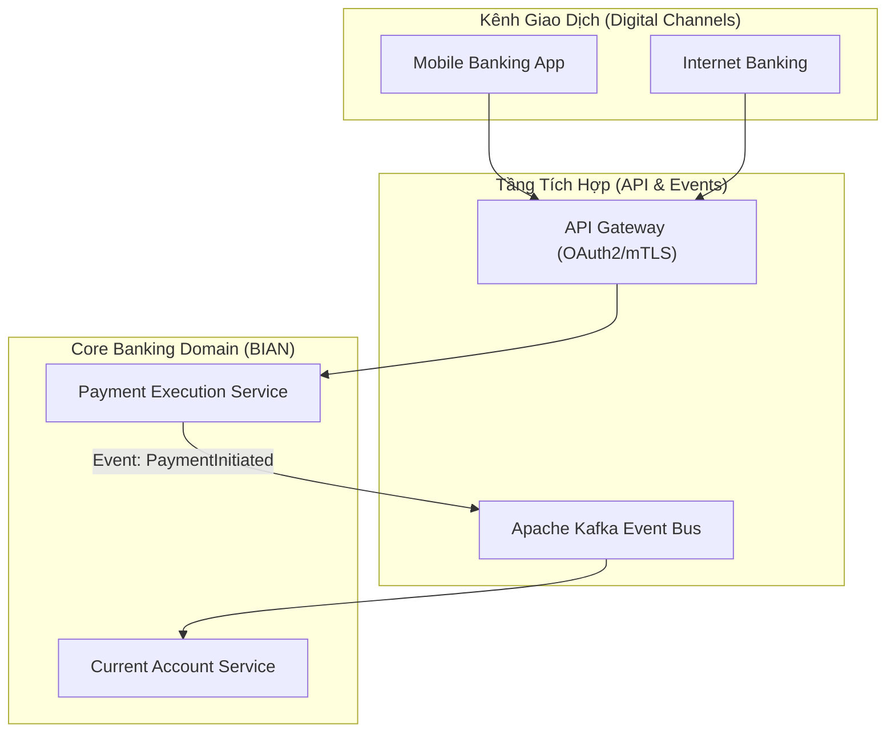
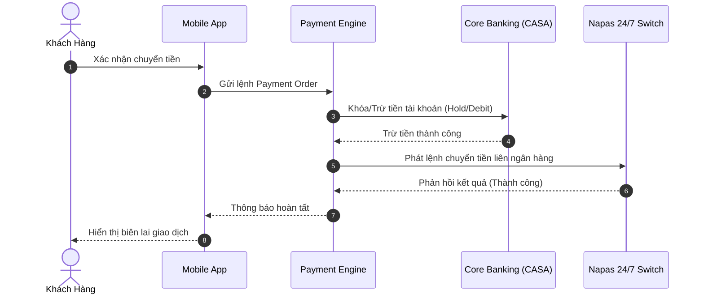

# Architecture & Sequence Diagram Guidelines

## 1. Nguyên Tắc Thiết Kế Sơ Đồ
1. **Rõ ràng và có định hướng (Clear Flow)**: Xác định rõ sơ đồ thể hiện luồng nghiệp vụ (Business Flow), luồng tích hợp (Integration Flow), hay cấu trúc dữ liệu (Data Model).
2. **Bọc nhãn bằng dấu ngoặc kép**: Tránh lỗi syntax parser của Mermaid khi chuỗi chứa dấu cách, dấu ngoặc hoặc ký tự đặc biệt:
   * Đúng: `node1["API Gateway (Kong / Envoy)"]`
   * Sai: `node1[API Gateway (Kong / Envoy)]`
3. **Màu sắc & Phân vùng (Subgraphs)**: Sử dụng `subgraph` để nhóm các service domain (ví dụ: Core Banking, Payment Gateway, External Switch).

## 2. Các Mẫu Sơ Đồ Thường Dùng

### Flowchart / Bounded Context

### Sequence Diagram (Giao tiếp nghiệp vụ ngân hàng)

