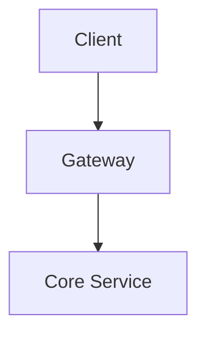

# New Post Wizard for Luong Dinh's Notes

Skill này hướng dẫn quy trình tạo bài viết mới chuẩn chỉ trên website `dhluong90.github.io`.

## Quy Trình 4 Bước Chuẩn

### Bước 1: Xác định Thể loại & Vị trí Lưu trữ
* **Chủ đề Ngân hàng (Banking Domain)**:
  * Lưu vào thư mục con tương ứng trong `docs/Banking Domain/` (ví dụ `Part_03_Core_Banking_CASA_Domain/`).
  * Đặt tên file: `ChXX_Ten_Bai_Viet_Viet_Tat.md`.
* **Chủ đề Công nghệ & AI (Tech)**:
  * Lưu vào `docs/Tech/`.
  * Đặt tên file theo ngày: `YYYY-MM-DD_slug-bai-viet.md` (ví dụ `2026-11-03_system_modernization_strangler_fig.md`).
* **Chủ đề Đời sống & Hồi ký (Life)**:
  * Lưu vào `docs/Life/` với tên file gợi nhớ, định dạng slug gạch dưới.

### Bước 2: Tạo Khung Bài Viết (Template)
Khung chuẩn một bài viết:
```markdown
# [Tiêu Đề Bài Viết Ngắn Gọn, Sâu Sắc]

*Ngày đăng: YYYY-MM-DD | Tác giả: Lương Đình | Chủ đề: [Banking/Architecture/Tech]*

---

## 1. Đặt Vấn Đề (The Context & Problem)
[Mô tả bối cảnh bài toán trong thực tế, các rào cản kỹ thuật/nghiệp vụ]

## 2. Mô Hình Kiến Trúc & Giải Pháp (Architecture Solution)
[Phân tích kiến trúc tổng quan, các trade-offs]



## 3. Phân Tích Kỹ Thuật Chuyên Sâu (Technical Deep-Dive)
[Chi tiết API payload, BIAN Service Domain, hoặc mã nguồn minh họa]

!!! tip "Kinh nghiệm thực chiến"
    [Lời khuyên xương máu rút ra từ triển khai production]

## 4. Tổng Kết & Bài Học Rút Ra (Summary & Takeaways)
[3-4 gạch đầu dòng đúc kết cốt lõi]
```

### Bước 3: Cập nhật Cây Điều Hướng (`mkdocs.yml`)
Nếu bài viết nằm trong danh mục có khai báo điều hướng rõ ràng, mở file `mkdocs.yml` và thêm đường dẫn file vào cây `nav`.

### Bước 4: Kiểm tra Build
Kích hoạt môi trường và chạy:
```bash
source venv/bin/activate
mkdocs build --strict
```
Bảo đảm không có cảnh báo nào về file mồ côi (unlinked files) hoặc gãy link.
