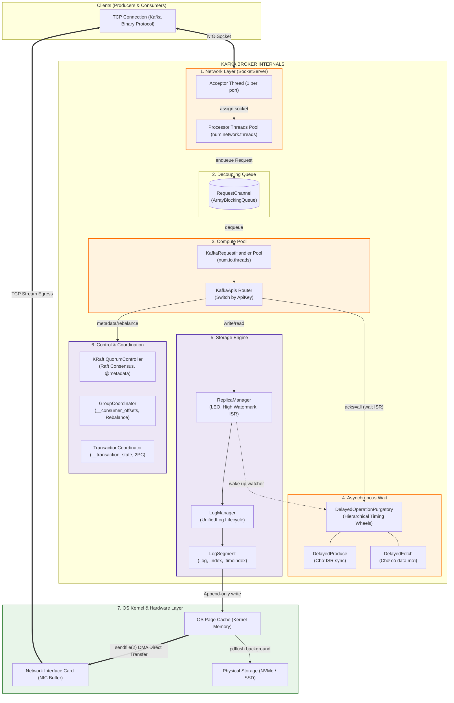

# Bản Phác Thảo Giải Phẫu Kafka: Mổ Xẻ 7 Cơ Quan Nội Tạng Của Một Broker

Khi tìm hiểu về Apache Kafka, hầu hết tài liệu đều dừng lại ở tầng khái niệm bề nổi: *Producers gửi tin vào Topics, chia thành các Partitions, rồi Consumers đọc ra*. Nhưng với một Solution / Enterprise Architect, cách tiếp cận đó không trả lời được các câu hỏi bản chất:

> *Tại sao Kafka gánh được hàng triệu message/giây mà JVM Heap chỉ cần 4GB?*  
> *Làm thế nào Broker giữ hàng trăm nghìn kết nối chờ `acks=all` mà không làm sập Thread Pool?*  
> *Mã nguồn bên trong một Broker gồm những linh kiện nào và phối hợp nhịp nhàng ra sao?*

Trang giải phẫu này mổ xẻ trực tiếp mã nguồn nội tại của **Apache Kafka Broker (`kafka.server`)** thành đúng **7 cơ quan nội tạng cốt lõi** và luồng luân chuyển dữ liệu thực tế.

---

## 1. Tấm Bản Đồ Giải Phẫu (Broker Internal Anatomy)

Một Broker không phải là một khối đen nguyên khối (monolith), mà là một dây chuyền phân tầng tách biệt hoàn toàn giữa **Tầng Mạng (Network)**, **Tầng Xử lý (Compute)**, **Tầng Chờ Bất đồng bộ (Purgatory)** và **Tầng Lưu trữ (Storage Engine)**:



---

## 2. Bóc Tách 7 Cơ Quan Nội Tạng Của Kafka Broker

| STT | Cơ quan / Component | Mã nguồn đại diện | Cấu trúc dữ liệu & Thuật toán | Trách nhiệm cốt tử & Bất biến (Invariants) |
| :-: | :--- | :--- | :--- | :--- |
| **1** | **`SocketServer`** | `kafka.network.SocketServer` | Java NIO `Selector`, Reactor Pattern | **Tiếp nhận mạng phi phong tỏa**: 1 `Acceptor Thread` chỉ nhận kết nối rồi ném cho pool `Processor Threads`. Processor đọc byte từ socket, parse header nhị phân rồi đẩy vào hàng đợi. |
| **2** | **`RequestChannel`** | `kafka.network.RequestChannel` | `ArrayBlockingQueue<Request>` | **Vùng đệm ngắt kết nối (Decoupling)**: Tách rời tốc độ nhận tin của Card mạng với tốc độ xử lý đĩa của CPU. Chống tràn bộ nhớ bằng cơ chế backpressure từ chối nhận nếu queue đầy. |
| **3** | **`RequestHandlerPool`** | `kafka.server.KafkaRequestHandlerPool` | Worker Thread Pool (`num.io.threads`) | **Bộ não thực thi nghiệp vụ**: Rút request từ queue, đối chiếu với `KafkaApis` (hơn 70 API keys: Produce, Fetch, Metadata, OffsetCommit...) để gọi xuống Storage Engine. |
| **4** | **`DelayedPurgatory`** | `kafka.server.DelayedOperationPurgatory` | **Hierarchical Timing Wheels** + Watcher Lists | **Xử lý tác vụ trễ bất đồng bộ `O(1)`**: Giữ các request cần chờ (như `acks=all` chờ Follower sync, hoặc `poll()` chờ có tin mới) mà **không block IO thread**. |
| **5** | **`LogManager & UnifiedLog`** | `kafka.log.LogManager`, `UnifiedLog` | Append-Only File + `mmap` Sparse Index | **Động cơ lưu trữ bất biến**: Quản lý các file Log Segment trên đĩa (`.log`, `.index`, `.timeindex`). Ghi tuần tự tuyệt đối (Sequential Write). Dọn rác bằng cách xóa nguyên file segment (`O(1)`). |
| **6** | **`ReplicaManager`** | `kafka.server.ReplicaManager` | In-memory Offset Trackers | **Bảo vệ tính toàn vẹn dữ liệu**: Quản trị hai con trỏ sinh tử: **LEO (Log End Offset)** và **HW (High Watermark)**. Duy trì danh sách ISR (In-Sync Replicas). |
| **7** | **`Control & Coordinators`** | `KRaftController`, `GroupCoordinator` | Event-driven State Machine, Raft Quorum | **Đầu não chỉ huy & Cân bằng nhóm**: Quản trị metadata cụm qua topic nội bộ `@metadata` (thay thế ZooKeeper); điều phối Consumer Rebalance qua topic `__consumer_offsets`. |

---

## 3. Vòng Đời Đi Xuyên 7 Bộ Phận Của 2 Request Kinh Điển

### Kịch bản A: Produce Request với `acks=all` (Ghi an toàn tuyệt đối)

```
[Producer] ──(1) TCP Raw Bytes──> [SocketServer: Processor]
                                           │ (2) Đóng gói Request
                                           ▼
                                   [RequestChannel]
                                           │ (3) Dequeue
                                           ▼
                                [RequestHandler: IO Thread]
                                           │
             ┌─────────────────────────────┴─────────────────────────────┐
             │ (4) Ghi vào Leader Partition                              │ (5) Chưa đủ ISR sync!
             ▼                                                           ▼
    [ReplicaManager / Log]                                  [DelayedOperationPurgatory]
     ├── Ghi vào OS Page Cache (.log)                        ├── Tạo Watcher gắn với Partition
     └── Cập nhật LEO = LEO + 1                              └── Giải phóng IO Thread ngay lập tức!
             │                                                           ▲
             │ (6) Follower gửi FetchRequest kéo dữ liệu                  │ (7) Watcher kích hoạt!
             └───────────────────────────────────────────────────────────┘
                                           │
                                           ▼ (8) Đủ ISR xác nhận &rarr; Vạch HW dâng lên
                                   [DelayedProduce hoàn tất]
                                           │
                                           ▼ (9) Đẩy response trả về Client: OK!
```

!!! tip "Tại sao Purgatory là tuyệt tác kiến trúc?"
    Nếu không có Purgatory, 8 worker thread của `num.io.threads` sẽ bị **block đứng chờ** 2 Follower sao chép xong. Chỉ cần 8 request đồng thời là toàn bộ Broker tê liệt. Với Purgatory (Timing Wheels), worker thread ghi vào Page Cache xong (mất ~5 micro-giây) là ném vào Purgatory rồi **lập tức quay sang phục vụ request khác**. Độ phức tạp thêm/xóa/check timeout đạt **`O(1)`**.

---

### Kịch bản B: Fetch Request & Đường Bay Thần Tốc "Zero-Copy"

Khi Consumer gửi yêu cầu đọc dữ liệu (`FETCH`), Kafka hoàn toàn **đứng tránh sang một bên** để phần cứng tự xử lý:

```
[Consumer] ──(1) Gửi FetchRequest (Offset: 1000)──> [IO Thread]
                                                         │
                                                         ▼ (2) Tra cứu Sparse Index (.index)
                                                   Tìm thấy Physical Position = 4096 (mmap O(log N))
                                                         │
                                                         ▼ (3) Gọi Linux System Call
                                                sendfile(socket_fd, file_fd, offset=4096, size=64KB)
```

Lúc này, đường truyền vật lý diễn ra hoàn toàn ở tầng Kernel:

```
[Đĩa cứng NVMe] ──(DMA Transfer)──> [OS Page Cache (Kernel Memory)]
                                                    │
                                                    │ (DMA Copy qua Linux sendfile)
                                                    ▼ (HOÀN TOÀN BYPASS JVM HEAP!)
                                           [Socket Buffer / NIC (Card mạng)]
                                                    │
                                                    └──(TCP Stream)──> [Consumer Client]
```

!!! note "3 Con số Invariant làm nên tốc độ triệu TPS"
    1. **0 lần CPU Copy**: Dữ liệu không bao giờ bị CPU nạp vào thanh ghi hay copy vào JVM User Space.
    2. **2 lần Context Switch**: Thay vì 4 lần như I/O truyền thống (User &harr; Kernel &harr; User &harr; Kernel), `sendfile(2)` chỉ tốn đúng 2 lần switch.
    3. **Zero Garbage Collection**: Không có bất kỳ Java Object byte array nào được cấp phát trên JVM Heap cho message payload, loại bỏ hoàn toàn thảm họa Stop-The-World của Java GC!

---

## 4. Ba Ranh Giới Bất Biến (Architectural Invariants) Không Thể Xâm Phạm

Mọi lập trình viên vận hành Kafka đều phải khắc cốt ghi tâm 3 bất biến thiết kế này:

### Invariant 1: Vạch Ngăn High Watermark (`Offset < HW`)
> **"Dữ liệu đã nằm trên đĩa của Leader chưa chắc đã là dữ liệu an toàn."**

* **LEO (Log End Offset)** là vị trí mới nhất Leader vừa append xong.
* **HW (High Watermark)** là vị trí mà node chậm nhất trong danh sách ISR đã bắt kịp.
* **Bất biến**: Consumer **tuyệt đối không bao giờ được phép đọc vượt qua HW**. Nếu cho phép đọc tới LEO, khi Leader bị sập nguồn đột ngột, Follower mới lên làm Leader chưa kịp có đoạn dữ liệu đó &rarr; Client sẽ bị lỗi **Phantom Read / Data Drift**.

### Invariant 2: Ghi Tuần Tự (Append-Only) Thay Vì Random I/O
Kafka không dùng cấu trúc B-Tree hay LSM-Tree như các cơ sở dữ liệu truyền thống. 
* Ghi dữ liệu: Luôn luôn là thao tác ghi nối tiếp vào cuối file segment (`O(1)`). Tốc độ ghi tuần tự của ổ cứng từ tính (HDD) có thể đạt **100 - 150 MB/s**, còn NVMe đạt **hàng GB/s**, tiệm cận trực tiếp tốc độ ghi vào RAM.
* Dọn dẹp dữ liệu: Khi hết hạn (Retention) hoặc nén log (Compaction), Kafka không tìm từng record để xóa. Nó **xóa đứt cả một file segment 1GB cũ** trên Linux File System với độ phức tạp `O(1)`.

### Invariant 3: Idempotency Không Cần Database (`ProducerStateManager`)
Để đảm bảo Producer retry mà không sinh ra tin nhắn trùng lặp (Exactly-Once Semantics), Kafka không tạo bảng deduplication trong database:
* Mỗi Producer được cấp 1 `ProducerId (PID)`. Mỗi message batch mang 1 số thứ tự tăng dần `SequenceNumber`.
* Trong `UnifiedLog`, component **`ProducerStateManager`** giữ trong RAM một bảng trượt gồm **5 Sequence Number gần nhất** của từng PID.
* Khi có message gửi tới:
  * Nếu `Seq == LastSeq + 1`: Chấp nhận, tăng `LastSeq`.
  * Nếu `Seq <= LastSeq`: Duplicate detected &rarr; Bỏ qua việc ghi đĩa, trả về ACK thành công ngay lập tức!
  * Bộ nhớ tiêu tốn cho việc chống trùng lặp: Chỉ vài kilobyte RAM cho mỗi Producer, tốc độ kiểm tra `O(1)`.

---

## 5. Lời Kết Của Kiến Trúc Sư

Khi bóc tách 7 cơ quan nội tạng bên trong Kafka, ta nhận ra triết lý thiết kế tối thượng của nó:

> **"Kafka không cố gắng làm mọi thứ trong phần mềm ứng dụng. Sức mạnh của Kafka đến từ sự thấu hiểu sâu sắc cách hoạt động của Hệ Điều Hành, Hệ Thống Tệp, Bộ Đệm Kernel và Phần Cứng Mạng để tối đa hóa hiệu năng dòng chảy dữ liệu."**

* Một khi hiểu được vai trò của **`SocketServer`** và **`RequestChannel`**, ta sẽ biết cách tinh chỉnh `num.network.threads` và `num.io.threads` tương ứng với số CPU cores.
* Một khi hiểu được bản chất của **`Purgatory`**, ta sẽ tự tin cấu hình `acks=all` và `min.insync.replicas` mà không sợ làm nghẽn hệ thống.
* Và một khi hiểu được cơ chế **`Zero-Copy`**, ta sẽ không bao giờ lãng phí hàng trăm gigabyte RAM để cấp cho JVM Heap vô ích.
