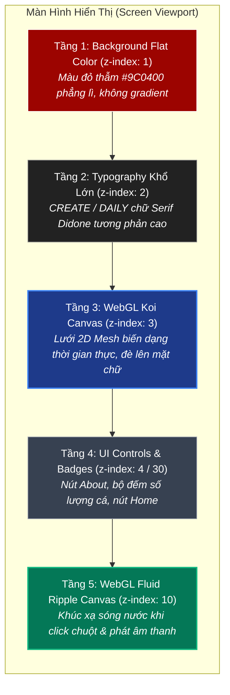

# Giải Mã Kỹ Thuật Interactive WebGL Hero — Đằng Sau Hiệu Ứng Cá Koi "Thôi Miên" Người Xem

> *"Một kỹ sư giỏi biết cách dùng kỹ thuật phức tạp để giải quyết bài toán khó. Nhưng một kiến trúc sư bậc thầy biết cách dùng một mẹo đơn giản, thanh lịch để tạo ra trải nghiệm thị giác đỉnh cao mà hệ thống vẫn nhẹ tênh."*

Mới đây, khi lướt qua tác phẩm [Koi Hero của Marina Budarina](https://marinabudarina.github.io/koi/), bất kỳ ai yêu cái đẹp của kỹ thuật đồ họa tương tác cũng đều phải dừng lại ngắm nghía: Những chú cá chép đuôi bướm (Butterfly Koi) uốn lượn mềm như lụa, vây voan mỏng dập dờn trong làn nước, khi click chuột thì mặt nước xao động khúc xạ cả mặt chữ bên dưới, kèm tiếng giọt nước rơi thanh thoát.

Trông hệt như một kỳ quan 3D được dựng kỳ công trong Blender với shader ánh sáng hàng triệu đa giác. Nhưng khi "mổ xẻ" mã nguồn bên dưới, sự thật còn thú vị hơn gấp bội: **Hoàn toàn không có mô hình 3D nào cả.** Toàn bộ sinh vật sống động đó được tạo nên từ **1 tấm ảnh 2D PNG phẳng lì** kết hợp với các thuật toán vật lý lượng giác cổ điển.

Bài viết này bóc tách toàn bộ kiến trúc đồ họa, phương trình chuyển động sinh học, và cẩm nang prompt kỹ thuật để bất kỳ ai cũng có thể tái tạo trải nghiệm này.

---

## 1. Trải Nghiệm Demo Trực Tiếp

Em đã nhúng và tối ưu hoàn chỉnh bản WebGL tương tác này vào ngay vườn số `dhluong90.github.io`:

👉 **[Trải Nghiệm Hồ Cá Koi Tương Tác Trực Tiếp Tại Đây ↗](/koi/){ .md-button .md-button--primary }**

!!! tip "Các điểm tương tác thú vị trong bản demo"
    * **Rê chuột**: Cá có AI định hướng riêng (*boids & obstacle avoidance*), tự lượn lờ (*wander*), bứt tốc quẫy đuôi (*dart*) và né tránh con trỏ.
    * **Click chuột**: Kích hoạt phương trình sóng nước WebGL (*Fluid Ripple Shader*), làm biến dạng mặt chữ bên dưới và phát âm thanh giọt nước (*coin plop*).
    * **Âm thanh Ambient**: Tự động mở khoá Web Audio sau cử chỉ tương tác đầu tiên, phát tiếng suối chảy thiền định.
    * **Bộ đếm cá**: Góc dưới bên trái cho phép tăng giảm từ 1 đến 5 dòng cá Koi (Kohaku đỏ, Asagi, Đen vây dài, Vàng kim, Trắng bạc).

---

## 2. Nghịch Lý 3D Trong Thiết Kế Web Hiện Đại

Khi nhận đề bài: *"Làm một trang web có cá bơi lội mềm mại theo chuột"*, phản xạ tự nhiên của 90% lập trình viên là:
1. Lên Sketchfab tải một model 3D cá Koi dạng `.gltf` hoặc `.fbx`.
2. Dùng Three.js dựng Scene, Camera, gắn xương (`SkinnedMesh`), nạp hoạt ảnh bơi lội (*Skeleton Animation Clips*).
3. Thêm đèn (*Directional Light*, *Ambient Light*) và bật bóng đổ (*Shadow Maps*).

### Hậu quả về mặt kiến trúc & hiệu năng (Architectural Trade-offs)
* **Dung lượng mạng (Payload)**: Một model 3D có xương chuyển động nhẹ nhất cũng 3MB – 8MB. Mạng chập chờn trên mobile sẽ khiến trang web trắng tinh mất vài giây.
* **Tải GPU & Ngốn Pin**: Render ma trận 3D, tính toán skinning 3 trục $(X, Y, Z)$ và đổ bóng khiến GPU điện thoại nóng bừng, quạt laptop quay vù vù, FPS tụt từ 60 xuống 25.
* **Độ phức tạp tích hợp**: Khó kết hợp mượt mà với typography phẳng và responsive theo tỷ lệ màn hình (viewport vw/vh).

Ngược lại, giải pháp **2D Mesh Skinning trên WebGL** đại diện cho triết lý *"Cheap Trick, Expensive Look"*:

| Tiêu chí | 3D Skeletal Mesh (Three.js/GLTF) | 2D Procedural Mesh Skinning (Phương án này) |
| :--- | :--- | :--- |
| **Asset kích thước** | 3MB – 10MB (Model + Rig + Anim) | **~600KB** (1 tấm ảnh PNG phẳng 2D) |
| **FPS trên Mobile** | 30 – 45 FPS (nóng máy, nghẽn GPU) | **60 – 120 FPS** (ổn định, mượt như nhung) |
| **Bộ nhớ (RAM)** | 120MB – 300MB | **< 25MB** |
| **Chuyển động** | Bị lặp đi lặp lại theo keyframe cố định | **Sinh học ngẫu nhiên (Procedural)**, không bao giờ trùng lặp |

---

## 3. Kiến Trúc Phân Tầng Thị Giác (Visual Layering Depth)

Điểm biến một trang web thành một "hồ nước có chiều sâu" chính là cách xếp chồng các lớp (`z-index`) rất thông minh:



Khi đàn cá bơi lội ở **Tầng 3**, thân cá và đặc biệt là những chiếc đuôi lụa bán trong suốt sẽ lướt đè lên các ký tự khổ lớn ở **Tầng 2**. Não bộ người dùng lập tức tự ráp nối và sinh ra ảo giác: *"Chữ nằm dưới đáy hồ, và cá đang bơi lượn trong làn nước phía trên!"*

---

## 4. Bốn Thuật Toán Cốt Lõi Tạo Nên Sự Sống

### 4.1. "Xẻ thịt" Sprite 2D thành lưới co giãn (2D Mesh Skinning)

Sprite gốc chỉ là một tấm ảnh PNG tĩnh chụp từ trên xuống, đầu cá hướng sang phải. Tác giả chia tấm ảnh thành một lưới toạ độ gồm hàng trăm ô vuông dẻo:

```
  Col 0     Col 1     Col 2               Col N
Row 0 +---------+---------+---------+ ... +---------+
      | (u0,v0) | (u1,v0) |         |     |         |
Row 1 +---------+---------+---------+ ... +---------+
      |         |         |         |     |         |
Row M +---------+---------+---------+ ... +---------+
   (Đuôi voan)   (Vây bụng)  (Thân cá)     (Mũi cá)
```

Toàn bộ ma trận đỉnh (`Float32Array`) này được CPU cập nhật toạ độ $(X, Y)$ mỗi khung hình dựa theo chuyển động của cột sống, rồi đẩy vào `WebGLBuffer` để card đồ hoạ vẽ tức thì.

### 4.2. Cột sống Kinematic & Sóng Hình Sin ($S$-Wave)

Cột sống cá được mô hình hoá bằng một mảng gồm $N$ đốt xương $(p_0, p_1, \dots, p_n)$:

1. **Đốt đầu ($p_0$)**: Di chuyển tự do theo vận tốc $v$ và góc quay $\theta$ (hướng tới mục tiêu hoặc né chuột).
2. **Các đốt thân ($p_i$)**: Bám theo đốt đứng trước nó ($p_{i-1}$) theo nguyên lý **Inverse Kinematics** (xích đoàn tàu hỏa). Khoảng cách giữa hai đốt luôn bằng một hằng số $L$:
   $$\vec{d} = p_i - p_{i-1}$$
   $$p_i = p_{i-1} + \frac{\vec{d}}{\|\vec{d}\|} \cdot L$$
3. **Sóng dọc thân (Travelling Sinusoidal Wave)**: Để cá không trườn đơ như một cọng dây thừng, một dao động sóng hình sin được cộng dồn theo thời gian:
   $$\text{offset}_i = A_i \cdot \sin(\omega \cdot t - i \cdot \phi)$$
   Trong đó:
   * $A_i$: Biên độ quẫy (ở đầu cá thì nhỏ, ra đến cuống đuôi thì cực đại).
   * $\omega$: Tần số quẫy (khi cá bứt tốc `dart`, $\omega$ tăng vọt tạo cảm giác cá đập đuôi dồn dập).
   * $\phi$: Độ lệch pha giữa các đốt xương, tạo thành hình chữ $S$ uốn lượn lan truyền từ đầu đến đuôi.

### 4.3. Vật lý dải lụa cho đuôi cá (Fabric Wave Physics)

Đây chính là điểm "ăn tiền" nhất. Nếu cái đuôi chỉ dính chặt vào đốt sống cuối cùng, nó sẽ ngoe nguẩy như một miếng nhựa cứng.

Tác giả đã chia phần đuôi lụa thành **3 thùy riêng biệt** (*Tail Lobes*: Thùy trên, thùy ngoài, thùy trong). Mỗi thùy được gắn một phương trình dao động quán tính trễ (*Lagging Swing*):

```typescript
// Tính góc lệch quán tính của từng thùy đuôi so với trục cột sống
for (let lobe = 0; lobe < 3; lobe++) {
  const targetHeading = fish.heading + fish.spineWave;
  // Thùy đuôi đuổi theo góc sống lưng nhưng bị trễ bởi lực cản nước
  fish.lobeAng[lobe] += (targetHeading - fish.lobeAng[lobe]) * LOBE_CATCHUP[lobe];
  fish.lobeSwing[lobe] = fish.lobeAng[lobe] - fish.heading;
}
```

* **Quy tắc biên độ cự ly**: Càng xa trục xương sống, biên độ dao động càng lớn. Điểm ở chóp đuôi dập dờn gấp 3 lần điểm ở cuống đuôi.
* **Độ trễ pha**: Khi cá quẹo gấp sang phải, cái đuôi lụa do lực cản chất lỏng vẫn bị văng về bên trái một nhịp rồi mới lả lướt trôi theo sau.

### 4.4. Shimmering Alpha (Độ mỏng xuyên thấu)

Trong Fragment Shader của WebGL, độ trong suốt (*Alpha*) được tính toán động:
* Phần thân cá: $\alpha = 1.0$ (đặc hoàn toàn).
* Phần rìa vây và đuôi voan: $\alpha$ giảm dần về $0.2 - 0.4$ kết hợp một chút nhiễu sóng nhẹ (*alpha shimmering*).
* Khi vây lướt qua thân con cá khác hoặc đè lên mặt chữ, hiệu ứng hoà trộn màu tạo cảm giác vải lụa voan mỏng đang ngập dưới nước.

---

## 5. Shader Mặt Nước Tương Tác (Fluid Ripple Refraction)

Trên cùng của giao diện là một WebGL Canvas riêng biệt đóng vai trò làm mặt nước:
1. **Phương trình sóng 2D**: Mỗi cú click chuột bổ sung một điểm nguồn dao động $(x, y, \text{amplitude})$.
2. **Normal Perturbation**: Shader tính vector pháp tuyến $(\vec{N})$ của mặt sóng nước đang lan tỏa.
3. **Khúc xạ (Refraction)**: Thay vì đọc texture ở toạ độ $(u, v)$ gốc, shader làm lệch toạ độ:
   $$(u', v') = (u, v) + \vec{N}_{xy} \cdot \text{refractionStrength}$$
   Nhờ đó, văn bản và hình ảnh phía dưới bị bẻ cong, méo mó theo hình vòng tròn gợn sóng như khi ta ném một viên sỏi xuống mặt hồ tĩnh lặng.

---

## 6. Cẩm Nang Prompt Blueprint Cho Kỹ Sư

Muốn chỉ dẫn AI (Antigravity, Claude Code, GPT) dựng một trang web tương tác theo trường phái này, hãy sử dụng cấu trúc prompt mẫu dưới đây:

```markdown
Xây dựng một trang Interactive Hero Landing Page WebGL hiệu năng cao:

1. Kiến Trúc Thị Giác (Visual Depth):
   - Background phẳng đơn sắc sang trọng (Dark Slate hoặc Vermillion).
   - Typo trung tâm khổ lớn (24vw, Didone / High-contrast Serif), đặt ở z-index: 2.
   - Canvas sinh vật tương tác đặt ở z-index: 3 (bơi đè lên chữ).
   - Canvas mặt nước tương tác đặt ở z-index: 10.

2. Mô Phỏng Chuyển Động (2D Mesh Skinning):
   - Tuyệt đối KHÔNG dùng 3D models (GLTF/FBX).
   - Dùng 1 ảnh 2D PNG trong suốt, biến dạng qua lưới toạ độ WebGL (tối thiểu 32x16 grid).
   - Xây dựng Spine gồm 10-12 đốt theo Kinematic Follow-chain + Travelling Sinusoidal S-wave.
   - Thêm Fabric Wave Physics cho phần vây/đuôi: chia thành nhiều thùy có độ trễ quán tính (lagging heading) và biên độ tăng dần theo khoảng cách ra mép ngoài.
   - Shimmering Alpha: vây lụa mỏng xuyên thấu khi đè lên các layer bên dưới.

3. Tương Tác & Âm Thanh:
   - Cá có AI tự định hướng (wander), bứt tốc (darting) và bơi né tránh chuột.
   - Click chuột kích hoạt WebGL Fluid Ripple Shader làm biến dạng khúc xạ chữ bên dưới kèm âm thanh giọt nước.
   - Kích hoạt AudioContext an toàn ngay sau cử chỉ chuột đầu tiên để phát ambient sound.
```

---

## 7. Lời Kết

Nghệ thuật phát triển phần mềm và kiến trúc hệ thống luôn có một điểm chạm rất thú vị: **Giải pháp tốt nhất không phải là giải pháp phô diễn nhiều công nghệ nặng nề nhất, mà là giải pháp tinh giản nhất đem lại kết quả vượt kỳ vọng.**

Hiệu ứng cá Koi của Marina Budarina là minh chứng hoàn hảo cho việc: Chỉ với toán học lượng giác cơ bản, một tấm ảnh 2D vẽ tay và tư duy phân tầng đúng đắn, ta hoàn toàn có thể tạo nên một tác phẩm tương tác làm say đắm người xem mà vẫn chạy mượt mà 120 FPS trên mọi thiết bị.

---

*Bài viết được biên soạn và xuất bản trong chuỗi nghiên cứu kiến trúc trải nghiệm số trên **[dhluong90.github.io](https://dhluong90.github.io/)**.*
